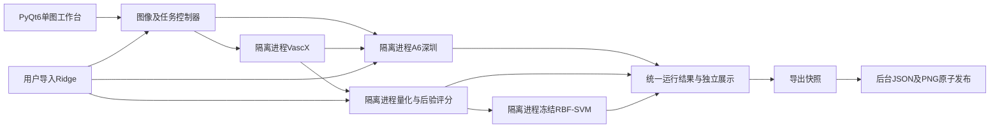
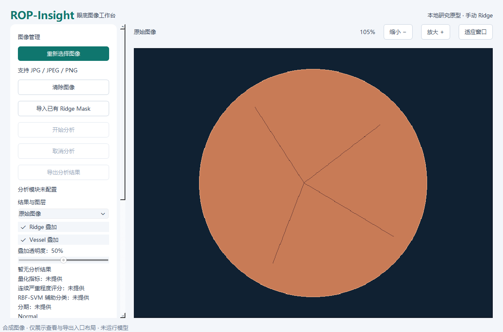

# 第六章论文材料索引

仅使用实际实现和验证结果；自动 Ridge 和全部 V1.0 验收尚未完成。

| 章节 | 材料 | 边界 |
| --- | --- | --- |
| 6.2 AI协同开发 | AGENTS.md、Git历史、[路线图](IMPLEMENTATION_ROADMAP.md)、[P4 Spec](P4_SPEC.md)、各阶段审查记录 | 本轮授权连续实施P4-A/B，历史提交用于追溯 |
| 6.3 总体设计 | [技术方案](TECHNICAL_PLAN.md)、下方模块图、[运行手册](RUNBOOK.md) | 手动Ridge及隔离算法环境如实标注 |
| 6.4 功能实现 | [A6](P2_E_A6.md)、[量化](P3_A.md)、[评分/SVM](P3_B.md)、[导出](P4_A.md)、[结构化报告](P5.md)、合成截图 | 合成图不作为真实诊断案例 |
| 6.5 测试与验证 | tests/、[系统验收](P4_B_VALIDATION.md)、[P5报告验证](P5.md)、[环境记录](ENVIRONMENT_LOCK.md)、本地参考证据 | 518条训练特征重放是工程复现，不是独立泛化性能 |

本机真实证据位于 `.runtime/p4-validation/`：environment.json、real/validation.json、partial/validation.json、large/validation.json、真实结果截图和导出目录。包含影像的证据未纳入Git；作为论文案例前需核对实际资料授权，不自动发布。

下图是合成界面示例，没有模型推理或诊断结果。可通过 `scripts/capture_demo.py --output .runtime/demo` 重新生成。

论文案例应保留输入哈希、模型/源码哈希、设备、软件commit/dirty、参考来源、比较容差、实际差异、样本范围和未完成项。不能将单次资源观察或工程对照扩大解释为临床有效性。

当前论文软件版本可引用v0.2.0研究预发布标签，功能更新见 [发布说明](releases/v0.2.0.md)。病例保存和历史恢复证据见 [P6](P6_SIMPLE_VALIDATION.md)、[P7](P7_SIMPLE_VALIDATION.md)。早期阶段记录在 [历史档案](archive/README.md)。
